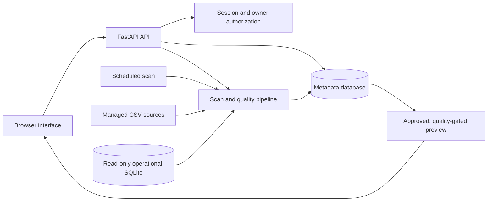

# Architecture and permissions

The metadata database uses SQLAlchemy and Alembic; SQLite and PostgreSQL share the same entities. Source snapshots, versions, access requests, quality runs, connector registrations and audit events persist there. Operational SQLite is opened read-only; table names are allowlisted. CSV registration copies content into randomly named managed files and rejects malformed data, excessive rows and unsafe column names. No user-provided SQL or arbitrary filesystem paths are accepted.

## Permissions

| Capability | Analyst | Steward | Administrator |
| --- | --- | --- | --- |
| Search metadata and see quality/lineage | Yes | Yes | Yes |
| Read data copies | Active approval only | Own assets or active approval | Yes |
| Edit definitions and review additive drift | No | Own team's assets | Any asset |
| Approve/reject/revoke requests | No | Own team's assets | Any asset |
| Approve own request | No | No | No |
| Register CSVs, scan sources, create accounts | No | No | Yes |
| Read audit trail | No | No | Yes |

Ownership is an exact team-name match. Users cannot set their own role or team. Administrators provision accounts; role reassignment and deactivation are not implemented as API workflows. Every preview, including an administrator read, requires ready asset status. Approval is a seven-day application entitlement checked on every preview request. It does not grant external source permissions. Responses are not browser-cacheable.

## Scan transaction and lineage

A database compare-and-set lease prevents overlapping scans. Scans compare observed headers with documented columns, evaluate source quality, and transform sales only when its three inputs pass. Results, snapshots, statuses and captured lineage commit in one metadata transaction. Connector errors block affected data; unexpected pipeline errors block all assets and preserve an error run. A crashed process lease expires after five minutes. Run one application worker to avoid migration/startup races.

This is a bounded in-memory batch operation. Sources do not share a transaction: use consistent exports or stop source writes when cross-source consistency matters. The fixed sales mapping is stored as run evidence when it executes. Arbitrary SQL/Python lineage is not inferred. Historical lineage is labelled after later failures. Imported CSVs remain independent until another transformation is implemented.

## Metadata and schema changes

Owner edits create a version and audit event. Revision checks prevent overwriting a concurrent edit. Schema drift clears the affected preview snapshot. Owners define every observed field before accepting an additive change or reordered columns. New fields default to personal, the dataset becomes confidential, and previous grants are revoked. A fresh scan is required.

Removed or renamed fields require an explicit transformation/quality-rule migration. Type drift is not inferred because supported source rows are strings; numeric rules detect invalid values. There is no transformation builder.

## Authentication and evidence

Passwords use salted PBKDF2-SHA256 with 600,000 iterations. Cookies are HttpOnly and SameSite Strict; only session token hashes are stored. Sessions expire after eight hours. Password changes invalidate all user sessions. Five failed attempts lock an account for fifteen minutes. Mutations require CSRF tokens, and browser origins must match APP_ORIGIN. Add deployment-level IP throttling for internet-facing login. Local passwords do not replace SSO/MFA.

Audit rows are append-only through the API but remain modifiable by database administrators. Use independently protected external logging for stronger evidence. Listings show up to 30 runs/versions and 200 request/audit events; older records remain stored. There is no automatic archive/purge.

References: [FastAPI lifespan](https://fastapi.tiangolo.com/advanced/events/) and [SQLAlchemy transactions](https://docs.sqlalchemy.org/en/20/orm/session_basics.html).

## Optional Microsoft Purview publisher

Administrator-only endpoints provide offline preview, read-only connectivity checks and publication through the Data Map API. Azure Identity obtains credentials on the server; tokens are not exposed to the browser or persisted. Custom dataset, column and Process entities use stable qualified names and are upserted in dependency order. Every published entity and Process dataset link is read back before success is recorded. A separate database lease serializes publishers, and persistent sync records retain the snapshot hash and verified remote GUIDs. Local scan outcomes remain independent of Azure publication outcomes. See [integration setup and boundaries](purview-integration.md).
